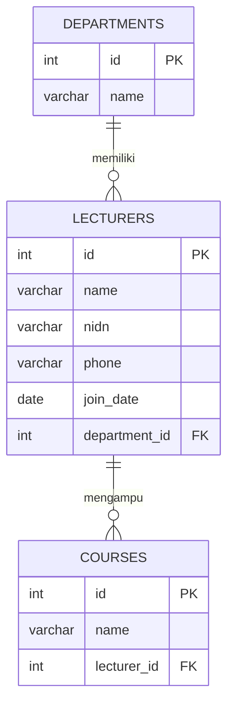

# Aplikasi Manajemen Data Akademik Lecturers

## Deskripsi Aplikasi

Aplikasi ini merupakan sistem manajemen data akademik berbasis web yang dibangun menggunakan PHP native tanpa framework. Aplikasi menyediakan pengelolaan data dosen (Lecturers), departemen (Departments), dan mata kuliah (Courses) dengan seluruh operasi Create, Read, Update, dan Delete (CRUD).

Proyek menggunakan pola arsitektur Model-View-Controller (MVC) agar logika aplikasi, akses database, dan tampilan dapat dipisahkan secara terstruktur. Tampilan antarmuka dibangun dengan Bootstrap dan aset Bootstrap disimpan secara lokal pada repositori.

## Desain Program

### Desain Basis Data

Basis data yang digunakan bernama `db_lecturers` dan memiliki tiga tabel utama, yaitu `departments`, `lecturers`, dan `courses`.



Hubungan antar tabel adalah sebagai berikut:

- Satu department dapat memiliki banyak lecturer. Relasi ini direpresentasikan oleh `lecturers.department_id`, yang merupakan Foreign Key menuju `departments.id`.
- Satu lecturer dapat mengampu banyak course. Relasi ini direpresentasikan oleh `courses.lecturer_id`, yang merupakan Foreign Key menuju `lecturers.id`.
- Setiap tabel menggunakan `id` sebagai Primary Key dengan nilai Auto Increment.
- Foreign Key menggunakan `ON UPDATE CASCADE` dan `ON DELETE CASCADE` agar data relasi tetap konsisten saat data induk diperbarui atau dihapus.

### Arsitektur dan Struktur Folder MVC

```text
root/
├── Project/
│   ├── assets/                 Aset Bootstrap, jQuery, dan Popper lokal
│   ├── config/                 Konfigurasi koneksi database
│   ├── models/                 Akses database dan operasi CRUD untuk setiap entitas
│   ├── controllers/            Pengendali permintaan dan alur proses aplikasi
│   ├── views/                  Tampilan daftar, form, dan template Bootstrap
│   ├── index.php               Pintu masuk serta pengaturan routing aplikasi
│   └── db_lecturers.sql        Salinan skema dan data awal database
├── Dokumentasi/                Tempat menyimpan video screen record hasil demo
├── db_lecturers.sql            Skema dan data awal database untuk diimpor
└── ReadMe.md                   Dokumentasi resmi repositori
```

Pembagian tanggung jawab pada aplikasi adalah:

- `config/` menyimpan konfigurasi koneksi database, meliputi host, nama database, user, dan password.
- `models/` berisi class `DB` untuk membuat koneksi PDO serta class model `Lecturer`, `Department`, dan `Course` untuk menjalankan kueri ke database.
- `controllers/` memproses permintaan dari pengguna, memanggil model yang diperlukan, menyiapkan data, dan memuat view yang sesuai.
- `views/` berisi tampilan daftar dan form untuk masing-masing entitas. Folder `templates/` menyimpan komponen header dan footer yang digunakan bersama oleh seluruh halaman.
- `assets/` menyimpan file CSS dan JavaScript Bootstrap beserta dependensinya agar aplikasi dapat dijalankan tanpa ketergantungan pada aset online.

## Alur Kerja Program

Alur eksekusi aplikasi dimulai ketika pengguna membuka `Project/index.php` melalui browser.

1. Pengguna mengakses halaman daftar atau mengirim permintaan melalui parameter URL `resource` dan `action`.
   - `resource` menentukan entitas yang diproses: `lecturers`, `departments`, atau `courses`.
   - `action` menentukan operasi: `index`, `create`, `store`, `edit`, `update`, atau `delete`.
2. `index.php` memuat koneksi database, seluruh model, dan controller yang diperlukan.
3. Berdasarkan parameter `resource`, `index.php` memilih `LecturerController`, `DepartmentController`, atau `CourseController`.
4. Method pada controller yang sesuai menjalankan logika CRUD.
5. Controller memanggil model untuk melakukan kueri menggunakan PDO dan prepared statement.
6. Data hasil kueri disiapkan oleh controller lalu dikirim ke view yang terkait.
7. View menampilkan data menggunakan komponen Bootstrap. Template header dan footer memuat navbar, CSS, dan JavaScript yang digunakan di setiap halaman.
8. Setelah proses tambah, ubah, atau hapus selesai, controller mengarahkan pengguna kembali ke halaman daftar entitas yang bersangkutan.

Contoh alur lecturer: pengguna membuka `Lecturer` → `LecturerController::index()` → `Lecturer::all()` menjalankan kueri dan JOIN department → hasil ditampilkan oleh `views/lecturers/index.php`.

## Cara Menjalankan Aplikasi

### Persyaratan

- PHP 8 atau versi yang didukung.
- MySQL atau MariaDB.
- Web server seperti Apache pada XAMPP/Laragon atau PHP built-in server.
- Ekstensi PDO MySQL aktif pada PHP.

### Konfigurasi Database Standar

Pastikan konfigurasi database di `Project/config/config.php` menggunakan nilai berikut:

```php
Host: localhost
Database: db_lecturers
User: root
Password: (kosong)
```

### Langkah Menjalankan

1. Tempatkan folder proyek pada direktori web server, misalnya `htdocs` untuk XAMPP atau direktori proyek Laragon.
2. Buat database dan tabel dengan mengimpor file SQL:

```bash
mysql -u root -p < db_lecturers.sql
```

Apabila menggunakan phpMyAdmin:

- Pilih atau buat database `db_lecturers`.
- Buka tab **Import**.
- Pilih file `db_lecturers.sql` dari root repositori.
- Jalankan proses impor hingga selesai.

3. Jalankan aplikasi menggunakan PHP built-in server:

```bash
cd Project
php -S localhost:8000
```

4. Buka aplikasi melalui browser:

```text
http://localhost:8000/index.php
```

Pengguna dapat mengelola Lecturer, Department, dan Course melalui navbar yang tersedia pada setiap halaman.

## Dokumentasi Hasil Program (Screen Record)

File atau tautan video screen record hasil demonstrasi aplikasi disimpan pada folder `Dokumentasi/`.

### Video Demonstrasi

Video screen record hasil pengujian CRUD aplikasi tersimpan pada:

```text
Dokumentasi/screen_record.webm
```

Video dapat diputar langsung dari repositori dengan pratinjau berikut:

<video controls width="720">
  <source src="Dokumentasi/screen_record.webm" type="video/webm">
  Browser Anda tidak mendukung pemutaran video.
</video>

Alternatif tampilan: [Buka video screen record](Dokumentasi/screen_record.webm)
